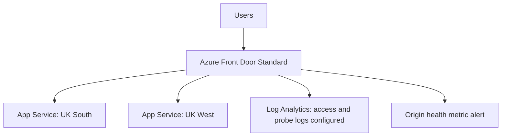

# Azure Highly Available Multi-Region Platform

An in-progress Azure Cloud Engineering learning lab. Building on my networking and identity projects, I am challenging myself to deploy an application across two regions, route requests through Azure Front Door and test how the platform behaves during an application outage.

## Project Status

**Current phase:** Core platform, access logging, CI and read-only Azure OIDC verified. Alert rule deployed; alert firing and notification delivery remain untested.

## Architecture

Both origins have equal priority and weight. Primary/secondary names identify resource roles; Front Door is configured for active-active routing.

Terraform manages the platform using remote state in Azure Storage. GitHub Actions validates the application and Terraform configuration. A separate OIDC workflow has Reader access to the project resource group; it does not deploy infrastructure or access Terraform state.

## Skills practised

- Two application deployments in separate Azure regions
- Azure Front Door Standard global routing
- Active-active traffic distribution
- Health probes and automatic regional failover
- Deliberate regional failure testing
- Azure Monitor and operational evidence
- Terraform remote state in Azure Storage
- GitHub Actions Terraform validation
- Azure OIDC authentication without stored client secrets

## Roadmap

- [x] Create GitHub repository
- [x] Create Terraform project foundation
- [x] Deploy resource group through Terraform
- [x] Deploy UK South App Service
- [x] Deploy UK West App Service
- [x] Deploy a region-aware test application
- [x] Configure Azure Front Door Standard
- [x] Configure health probes and load balancing
- [x] Validate active-active routing
- [ ] Complete regional outage and recovery validation (initial test recorded one HTTP 403)
- [x] Add monitoring and operational evidence
- [x] Add GitHub Actions CI
- [x] Add Azure OIDC authentication
- [x] Document current architecture, troubleshooting and limitations
- [ ] Validate alert firing and resolution
- [ ] Configure and test notification delivery

## Regions

- Primary region: UK South
- Secondary region: UK West

## Engineering Goal

The platform should continue serving user traffic when one application region becomes unavailable. Azure Front Door will evaluate origin health and route requests to healthy application origins.

## Validation so far

- Both regional application health endpoints returned HTTP 200.
- The Front Door health endpoint returned HTTP 200 with a healthy response.
- Ten requests through Front Door reached both regions: three UK South and seven UK West. This small sample demonstrates both origins serving requests, not a guaranteed traffic ratio.
- During a UK South app-stop test, four requests succeeded through UK West and one returned HTTP 403. This is partial failover evidence; it does not demonstrate uninterrupted availability. After restarting UK South, its health endpoint recovered and a further ten Front Door requests all succeeded across both regions (three UK South, seven UK West). A timed repeat outage test remains outstanding.
- New Front Door requests initially returned an HTML 404 configuration page. Requests later succeeded after propagation time and a resubmission of the existing route settings; the exact cause was not isolated.

## Monitoring and alert evidence

- Front Door access and health-probe diagnostic categories are enabled and directed to a 30-day Log Analytics workspace.
- A KQL query returned 23 access-log records; all 23 had HTTP status 200. Health-probe log ingestion has not yet been verified.
- The enabled origin-health alert evaluates each origin/origin-group series every minute and checks whether average health is below 90% over five minutes.
- Alert deployment is confirmed in Terraform state and a subsequent plan reported no changes. Firing, resolution and notification delivery have not been tested; no action group is connected.
- Logging began after the first outage test, so those logs cannot establish the cause of the earlier HTTP 403.

## GitHub Actions evidence

- [Successful app and Terraform validation run](https://github.com/olumideakinseye77-glitch/azure-multi-region-platform/actions/runs/39049879860): Flask health-response assertions, Terraform formatting, backend-free initialization and validation.
- [Successful Azure OIDC verification run](https://github.com/olumideakinseye77-glitch/azure-multi-region-platform/actions/runs/39049879898): Azure login without a client secret, followed by a resource-group read.
- The dedicated service principal has Reader access scoped to this project's resource group. Its federated credential trusts this repository's main branch.
- These workflows demonstrate CI and authentication verification, not automated deployment.

## Troubleshooting lessons

- A UK South B1 quota of zero blocked deployment; the approved increase to one allowed the plan to be created.
- Cloud Shell token timeouts required renewed tenant-specific authentication. Remote state and pushed Git commits allowed recovery after temporary session files were cleared.
- UK South resources created through Azure CLI were imported into Terraform. Configuration was aligned with the deployed application, including region settings and Gunicorn startup.
- Basic FTP/Web Deploy authentication was explicitly disabled instead of accepting provider defaults.
- Log queries initially returned no records; later queries confirmed ingestion. A successful query connection alone did not prove logs had arrived.
- An initial Front Door 404 cleared later, despite API deployment fields still reporting NotStarted. The exact reason was not isolated; working HTTP responses were verified separately.

## Cost and operational limits

Two B1 plans, Front Door Standard, log ingestion and metric alerts can incur charges. Stopping a web app does not stop its App Service plan charges. The workspace's 0.1 GB daily cap is an ingestion control, not a guaranteed spending limit. The earlier Traffic Manager experiment may also incur charges while it remains deployed.

## What I want to learn next

I want to strengthen this lab with timed outage evidence and an end-to-end alert notification test. The next challenge is turning collected logs into useful operational decisions. My next planned project is an AI-Assisted Azure Operations & Incident Lab, where I intend to challenge myself with log analysis, incident investigation and carefully reviewed automation.

## Scope and limitations

This is a portfolio lab, not a production service. It currently demonstrates application routing across regions, without a database, replicated data or a validated production recovery objective. The earlier Traffic Manager priority-routing experiment is separate from the Front Door active-active design. UK South was created through Azure CLI and imported into Terraform; both regional applications are now tracked in remote Terraform state.
