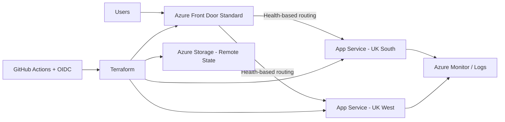

# Azure Highly Available Multi-Region Platform

An in-progress Azure Cloud Engineering learning lab. Building on my networking and identity projects, I am challenging myself to deploy an application across two regions, route requests through Azure Front Door and test how the platform behaves during an application outage.

## Project Status

**Current phase:** Front Door deployed; active-active routing verified; outage testing in progress.

Monitoring, GitHub Actions and OIDC are planned work, not completed capabilities.

## Target Architecture

## What This Project Will Demonstrate

- Two application deployments in separate Azure regions
- Azure Front Door Standard global routing
- Active-active traffic distribution
- Health probes and automatic regional failover
- Deliberate regional failure testing
- Azure Monitor and operational evidence
- Terraform remote state in Azure Storage
- GitHub Actions Terraform validation
- Azure OIDC authentication without stored client secrets

## Roadmap

- [x] Create GitHub repository
- [x] Create Terraform project foundation
- [x] Deploy resource group through Terraform
- [x] Deploy UK South App Service
- [x] Deploy UK West App Service
- [x] Deploy a region-aware test application
- [x] Configure Azure Front Door Standard
- [x] Configure health probes and load balancing
- [x] Validate active-active routing
- [ ] Complete regional outage and recovery validation (initial test recorded one HTTP 403)
- [ ] Add monitoring and operational evidence
- [ ] Add GitHub Actions CI
- [ ] Add Azure OIDC authentication
- [ ] Complete final architecture and troubleshooting documentation

## Regions

- Primary region: UK South
- Secondary region: UK West

## Engineering Goal

The platform should continue serving user traffic when one application region becomes unavailable. Azure Front Door will evaluate origin health and route requests to healthy application origins.

## Validation so far

- Both regional application health endpoints returned HTTP 200.
- The Front Door health endpoint returned HTTP 200 with a healthy response.
- Ten requests through Front Door reached both regions: three UK South and seven UK West. This small sample demonstrates both origins serving requests, not a guaranteed traffic ratio.
- During a UK South app-stop test, four requests succeeded through UK West and one returned HTTP 403. This is partial failover evidence; it does not demonstrate uninterrupted availability. Recovery verification and a timed repeat test remain outstanding.
- New Front Door requests initially returned an HTML 404 configuration page. Requests later succeeded after propagation time and a resubmission of the existing route settings; the exact cause was not isolated.

## What I want to learn next

I want to improve this lab by capturing timed outage evidence, adding monitoring and alerts, and validating Terraform through GitHub Actions with OIDC authentication. My next planned project is an AI-Assisted Azure Operations & Incident Lab, where I intend to challenge myself with log analysis, incident investigation and carefully reviewed automation.

## Scope and limitations

This is a portfolio lab, not a production service. It currently demonstrates application routing across regions, without a database, replicated data or a validated production recovery objective. The earlier Traffic Manager priority-routing experiment is separate from the Front Door active-active design. UK South was created through Azure CLI and imported into Terraform; both regional applications are now tracked in remote Terraform state.
