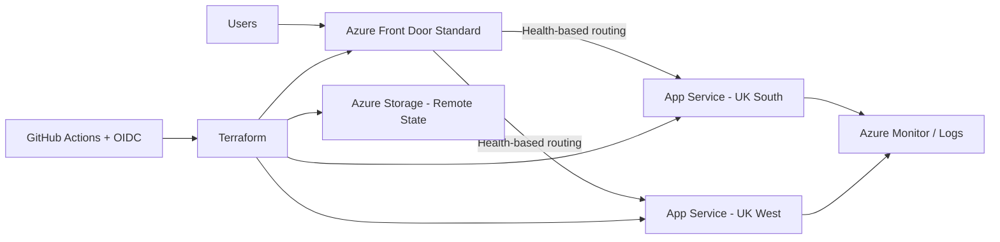

# Azure Highly Available Multi-Region Platform

Azure Cloud Engineering portfolio project demonstrating regional resilience, global traffic routing, health-based failover, monitoring, Infrastructure as Code, and secretless CI authentication.

## Project Status

**Current phase:** Foundation  
**Overall progress:** 10%

## Target Architecture

## What This Project Will Demonstrate

- Two application deployments in separate Azure regions
- Azure Front Door Standard global routing
- Active-active traffic distribution
- Health probes and automatic regional failover
- Deliberate regional failure testing
- Azure Monitor and operational evidence
- Terraform remote state in Azure Storage
- GitHub Actions Terraform validation
- Azure OIDC authentication without stored client secrets

## Roadmap

- [x] Create GitHub repository
- [x] Create Terraform project foundation
- [ ] Deploy resource group through Terraform
- [ ] Deploy UK South App Service
- [ ] Deploy UK West App Service
- [ ] Deploy a region-aware test application
- [ ] Configure Azure Front Door Standard
- [ ] Configure health probes and load balancing
- [ ] Validate active-active routing
- [ ] Perform deliberate regional failure test
- [ ] Add monitoring and operational evidence
- [ ] Add GitHub Actions CI
- [ ] Add Azure OIDC authentication
- [ ] Complete final architecture and troubleshooting documentation

## Regions

- Primary region: UK South
- Secondary region: UK West

## Engineering Goal

The platform should continue serving user traffic when one application region becomes unavailable. Azure Front Door will evaluate origin health and route requests to healthy application origins.
